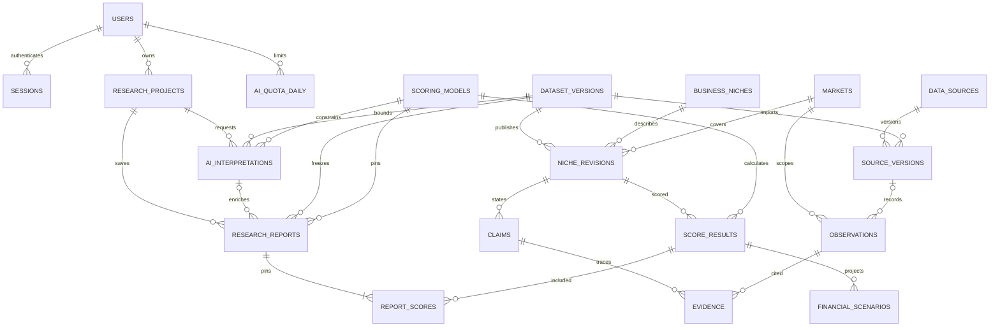

# Модель данных PostgreSQL

Имена в snake_case. PK — UUID, за исключением справочников с текстовыми кодами. FK обязательны, если не отмечены как nullable. Моменты — timestamptz UTC, календарные даты — date. Даты с точностью до месяца, квартала или года хранятся с period_label и period_precision. При неизвестной дате допускается null с причиной. Числа источников — numeric, деньги калькулятора — bigint в целых RUB, баллы — точные пары числитель/знаменатель. Опубликованные записи неизменяемы. Снимок отчёта хранит ссылки и сериализацию отображаемых данных.

## Словарь

| Сущность | Поля и смысл |
| --- | --- |
| users | id, login unique, password_hash, enabled, created_at. Одна учётная запись на старте. |
| sessions | token_digest unique, user_id, expires_at, revoked_at nullable. |
| research_projects | id, user_id, title, filters_json (CatalogFilters), created_at, updated_at. Индекс по владельцу и времени. |
| markets | id, country_code, region_code nullable, name. Уникальный код страны и региона с одним национальным срезом. |
| business_niches | id, legacy_code unique, slug unique. Стабильная идентичность карточки. |
| dataset_versions | id, version unique, manifest_sha256 unique, source_commit, published_at, manifest_json с хешами файлов, importer_version. История выпусков определяется published_at. |
| niche_revisions | id, niche_id, dataset_id, market_id, title, industry_code, segment, summary, updated_at. Unique(dataset_id, niche_id) в пилоте. |
| data_sources | id, source_code unique (S01–S30), publisher, title, kind. |
| source_versions | id, source_id, dataset_id, version, url, published_on nullable, retrieved_at, availability (readable/unavailable/shell), access_mode, license_note, caveats, artifact_locator nullable, sha256 nullable, supersedes_id nullable. Уникальная версия в пределах источника. retrieved_at для старого аудита может отсутствовать при наличии retrieved_on. retrieved_on обязателен. |
| observations | id, source_version_id nullable для локальных допущений, market_id, kind (fact/calculation/estimate/hypothesis), metric, value numeric nullable, text_value nullable, unit nullable, currency nullable, period_start/end nullable, period_label, period_precision, population, locator, method_version, limitations, input_ids nullable для производных наблюдений. Денежные данные сохраняют basis (номинальные либо приведённые) и валюту. |
| claims | id, niche_revision_id, section, kind, statement, gap_reason nullable. Разделы — demand, competition, risk, economics, criterion, gap. |
| evidence | id, claim_id, observation_id, relation (supports/qualifies/contradicts), locator, reviewer, reviewed_at, note. Индексы по claim и observation. |
| scoring_models | id, version unique, calculator_commit, calculator_sha256, rubric_json, criteria_order, weights_json, runtime_version, published_at. |
| score_results | id, niche_revision_id, scoring_model_id, input_hash, inputs_json (оценки, уровни качества, ID claims по критерию), lower/upper/confidence/coverage как точные дроби для v2, legacy_score nullable для v1, calculated_at. Unique(niche_revision_id, scoring_model_id, input_hash). Места выводятся в пределах выпуска и версии из точных баллов. |
| financial_scenarios | id, score_result_id, scenario_code, input_hash, finance_version, currency, unit, price, variable, fixed, volume, start_min, start_max, revenue, variable_total, contribution, unit_margin, break_even nullable, basis_kind, calculated_at. Unique(score_result_id, scenario_code). Коды low/base/high и шесть из finance_stresses. Связь с основаниями через claims и evidence. |
| ai_interpretations | id, user_id, project_id, dataset_id, scoring_model_id, score_result_ids, input_hash, idempotency_key, status, prompt_version, provider/model nullable, output_json nullable, error_code nullable, attempts, lease_until nullable, created_at, updated_at, token_usage nullable, budget_reservation nullable. Unique(user_id, idempotency_key). |
| research_reports | id, project_id, dataset_id, scoring_model_id, version, filters_snapshot, snapshot_json, sha256, interpretation_id nullable, created_at. Unique(project_id, version). |
| report_scores | report_id, score_result_id, position. Composite PK(report_id, score_result_id), unique(report_id, position). |
| ai_quota_daily | user_id, quota_day, requests, reserved_units, spent_units. Composite PK(user_id, quota_day). |

Версия источника включает происхождение и состояние на дату получения. Новая проверка меняет статус в следующем выпуске, старые отчёты сохраняют исторический статус. При пересмотре ряда создаётся новая версия с supersedes_id. Даты публикации и периода наблюдения независимы. При публикации факт требует проверяемого основания, расчёт — метода и входов, оценка/гипотеза — явного допущения. Пропуски U/P — null и качество 0. Импорт проверяет, что утверждения, наблюдения, результаты и отчёты принадлежат одному выпуску там, где это требуется. База запрещает разрыв FK и межпользовательскую связь проекта и интерпретации через составной FK (project_id,user_id); отчёт может ссылаться только на интерпретацию того же проекта, версии, набора результатов. Запись версии отчёта сериализуется блокировкой строки проекта. Права проверяются по owner_id через project.user_id. История публикаций и отчётов append-only, сохранённые отчёты не меняются при обновлении выпуска.

## ER-диаграмма

[Границы сервиса](system-design.md) · [Контракт](api-contract.yaml)

## Проекция в API

| Схемы OpenAPI | Источник данных и преобразование |
| --- | --- |
| Session | sessions + users; токен CSRF выдаётся сервером и не заменяет cookie. |
| Dataset, Market, Niche | dataset_versions + markets + niche_revisions + business_niches. Niche.id — стабильный business_niches.id; детализация всегда в контексте dataset_id. |
| Model, Score, Criterion | scoring_models и score_results; параметры критерия и ID оснований из inputs_json. Для сортировки используются точные дроби, JSON содержит числа и места в полном выпуске. |
| Claim, Evidence, Observation, SourceVersion | claims → evidence → observations → source_versions → data_sources. Выдача содержит только разрешённую для повторного использования проекцию. |
| Finance | financial_scenarios; для стресс-кода входы отражают изменённый сценарий и его округление, стартовый бюджет хранится отдельно от месячного вклада. |
| Project, ReportSummary, Report | research_projects и research_reports, где полный снимок содержит значения items, sources и interpretation на момент сохранения. |
| Interpretation | ai_interpretations; status_url строится из ID проекта и интерпретации. Usage, хеши и lease остаются внутренними. |

Для POST с ключом идемпотентности используется таблица request_idempotency(user_id, operation, scope_id, key, request_hash, resource_id, status_code, created_at), уникальная по владельцу, операции, области и ключу. Резерв и итог ресурса пишутся в одной транзакции. Отдельный ключ каталога для курсора подписывается сервером, привязывается к фильтрам и выпуску, а для частных коллекций ещё и к владельцу.
