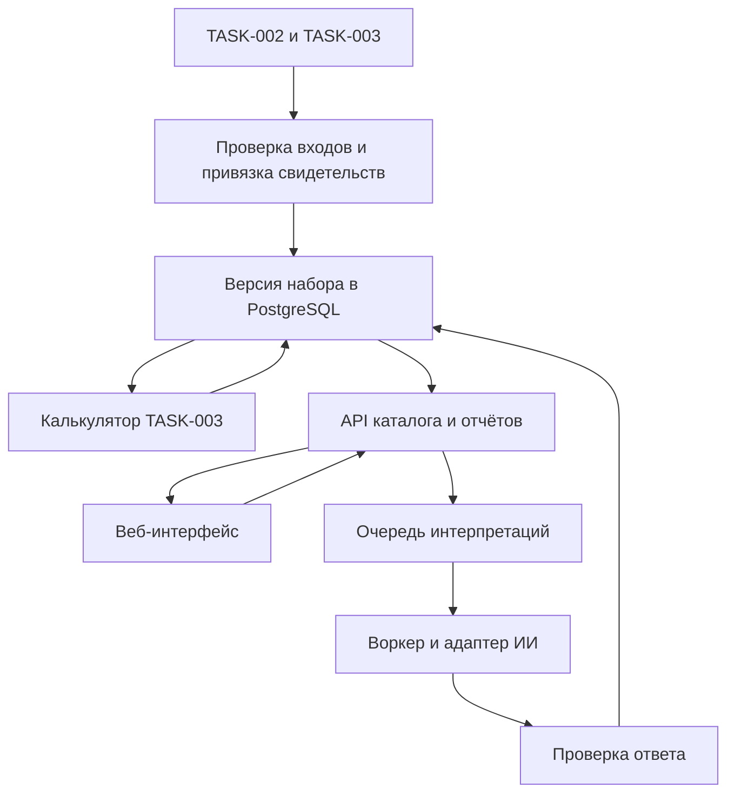

# Системная архитектура

Предложение — модульный монолит FastAPI, PostgreSQL, отдельный веб-интерфейс Next.js и один воркер из того же Python-пакета для ИИ. Маршруты раздавать под одним origin, включая /api/v1. Модули внутри API — импорт, каталог/доказательства, аналитика, исследования и ИИ. API владеет SQL и проверкой доступа. UI использует контракт и форматирует результаты. Воркер читает задания и обращается к адаптеру провайдера. Развёртывание MVP локальное через Compose, CI проверяет контракт, импорт и приложение при реализации.

| Решение | Альтернатива и аргумент |
| --- | --- |
| FastAPI + Python | Единый Next.js-сервер уменьшает число процессов, но требует границы с Python либо переноса проверенной модели. Django даёт готовую админку, которую сценарий пилота не требует. FastAPI оставляет расчёт в его языке и даёт явный API. |
| PostgreSQL + SQLAlchemy/Alembic | SQLite проще для прототипа одного пользователя, но затрудняет конкурирующие записи воркера и API. PostgreSQL даёт транзакции, FK и SKIP LOCKED. Цена выбора — локальный контейнер и управление миграциями. |
| Next.js + TypeScript | Vite SPA дешевле в эксплуатации как статика и технически достаточна. Next.js предложен ради маршрутов и согласованного UI-стека команды. Публичные страницы и SEO не нужны для пилота. |
| Очередь в PostgreSQL | Синхронный вызов ИИ привязывает результат к HTTP-соединению. Redis/Celery дают более богатую очередь с дополнительным сервисом. Один SQL-воркер покрывает пилот и держит запись задания в транзакции с резервом квоты. |
| Compose + GitHub Actions | Ручной запуск дешевле в настройке, сложнее воспроизвести. Compose фиксирует сервисы, Actions дают повторяемые проверки при PR. Платные среды требуют решения владельца. |
| Сменяемый адаптер ИИ | Прямой вызов SDK в маршруте проще для демо, но связывает формат API, тесты и сбои с одним провайдером. Интерфейс адаптера допускает локальную заглушку и запуск без ключа. |

## Импорт и пересчёт

1. Фиксировать SHA материалов, хеши входных файлов и манифест выпуска. Ключ ниши — исходный ID 01–20. Связать v1.json и v2.csv по ID, finance.csv добавить по совпадающему ID. Реестр S01–S30 переносить из аудита, сопоставляя факты с конкретным фрагментом, определением и географией. Строка evidence из CSV даёт подсказки для ручной привязки, включая диапазоны ID. Допущения сохраняются явно. Отсутствующее поле остаётся неизвестным с причиной.
2. Валидировать staging, транзакционно публиковать неизменяемый выпуск и атомарно переключать текущий указатель. Повторный импорт того же манифеста возвращает существующий выпуск. Выпуски с нарушенными ссылками или неполным манифестом остаются недоступны.
3. Закрепить [model.py](../../analysis/TASK-003/calculator/model.py) по SHA базы. Backend вызывает функции через адаптер с типизированными входами. Для score_v2 передавать D/U/C/P/I/S/R и q в том же порядке; пустая оценка → None, качество 0. Использовать finance(price, variable, fixed, volume) и finance_stresses для шести однофакторных прогонов. Суммы в целых RUB, входы хранить в RUB/ед. и RUB/месяц. Порог null означает недостижимую безубыточность при заданных условиях. Отдельно хранить стартовый диапазон.
4. Сортировать по точной нижней границе, равным значениям давать общие места по правилам TASK-003. Стабильный вторичный ключ ID используется только для порядка вывода. Confidence выводить отдельно. Хранить числитель/знаменатель; округлять для отображения. v1 доступна для истории, её шкалу не смешивать с v2. Исторический расчёт воспроизводится по неизменяемым оценкам, хешу входов и версии runtime/метода.
5. Снимки результатов выпуска вычисляются при импорте; API пересчёта синхронно получает либо создаёт запись с тем же уникальным ключом входов. Запуск 10 000 прогонов v1 остаётся офлайн проверкой. Финансовая чувствительность в MVP использует исходные стресс-прогоны TASK-003; изменение весов и ручное редактирование входов остаются за пределами API.

## Поток данных

Контракт границ — [OpenAPI](api-contract.yaml), [модель данных](database-schema.md) и [правила ИИ](ai-integration.md).
